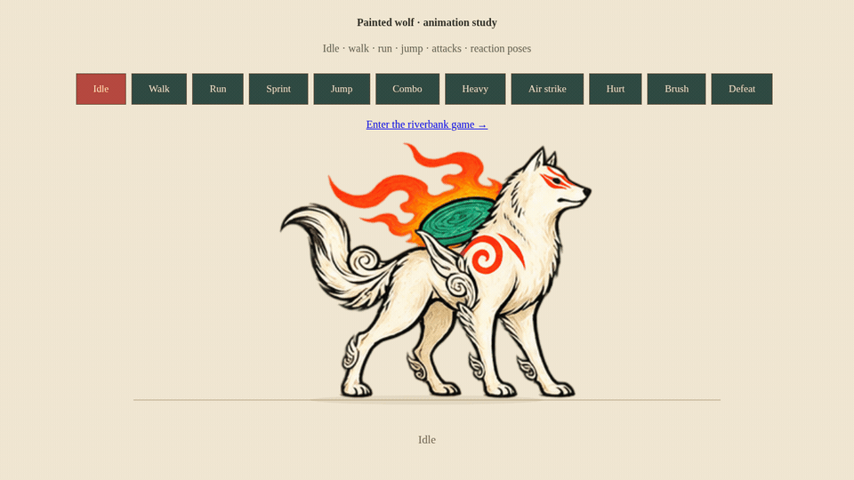
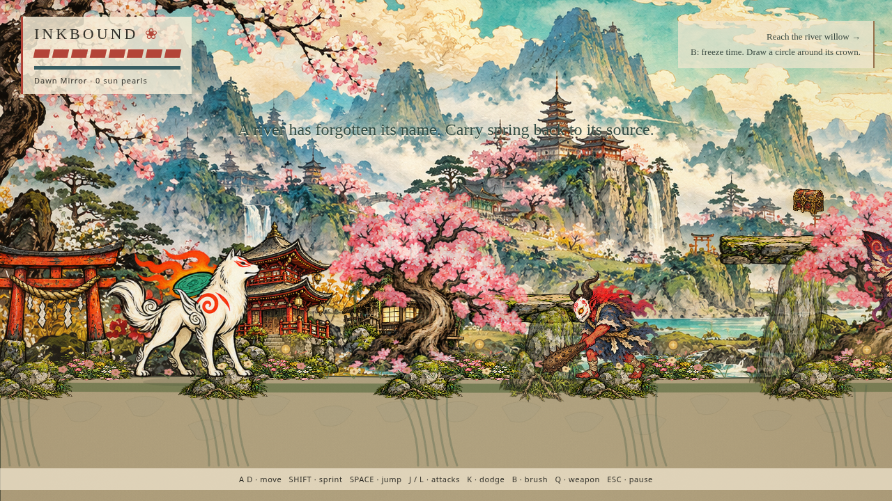

# Painted wolf revision

This revision is on **inkbound-painted-wolf**. The previous 2D prototype and the 3D game remain on their own branches. Only the 2D project changes here.

## Wolf alone

## In the level

These are actual browser captures. The artwork uses AI-assisted local painted sprite sheets based on the supplied reference. There are 32 wolf poses, 32 enemy poses and 16 painted props. Playback and gameplay are implemented in the game; this is not a pre-rendered trailer or a claim of commercial-quality authored animation.

The new download includes the compiled game and source in a separate `inkbound-2d` folder. Extract into a new location and run **START-2D-GAME.cmd**. Keep the previous game folders.

For the character alone, open the animation viewer from the game title screen, double-click `START-WOLF-STUDIO.cmd`, or open `/wolf-studio.html` on the same local server.

Gameplay validation remains separate from visual acceptance. See `validation.json` and `playthrough.json` for runtime evidence; the user still needs to judge the art and motion.
