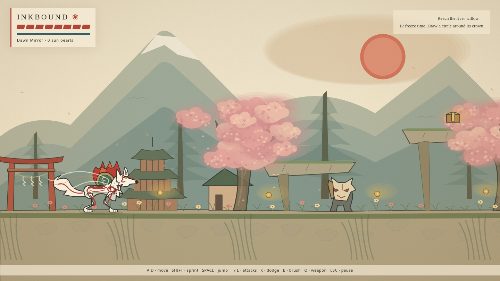
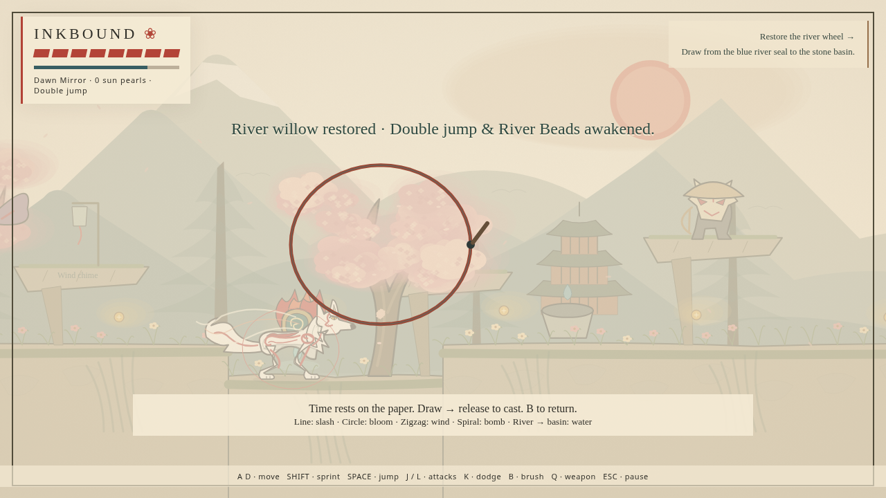
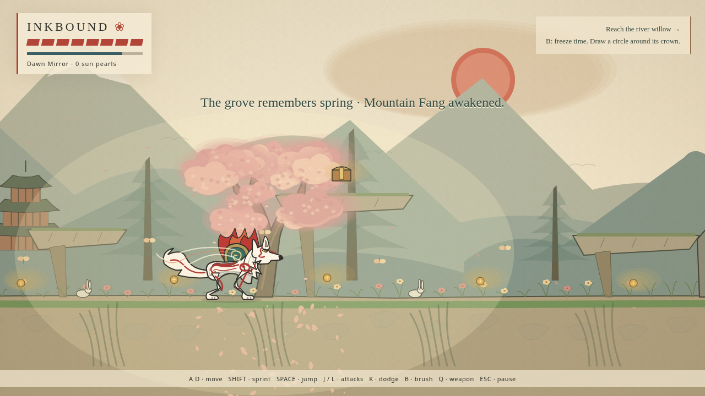

# Inkbound — first playable review

This branch **only adds `inkbound-2d/`**. The existing Three.js game and wolf viewer files remain byte-for-byte unchanged. The old playable `sunward-minigame` branch is also untouched.

## Riverbank / original divine wolf

## Draw on the world

## Restored grove

The images above are real browser captures, not concept art. The illustration is local, high-resolution Canvas 2D artwork. Character art and motion still need the user's aesthetic review; a successful build cannot establish that they meet the user's taste.

The focused keyboard/mouse browser checks are recorded in [validation.json](validation.json). They use isolated state fixtures to exercise individual gameplay systems. The separately recorded full-route playthrough uses only actual inputs; see [playthrough.json](playthrough.json) for its outcome and route milestones.

Run the new project with `START-2D-GAME.cmd` inside `inkbound-2d/`. Keep your old game folder and launcher.
