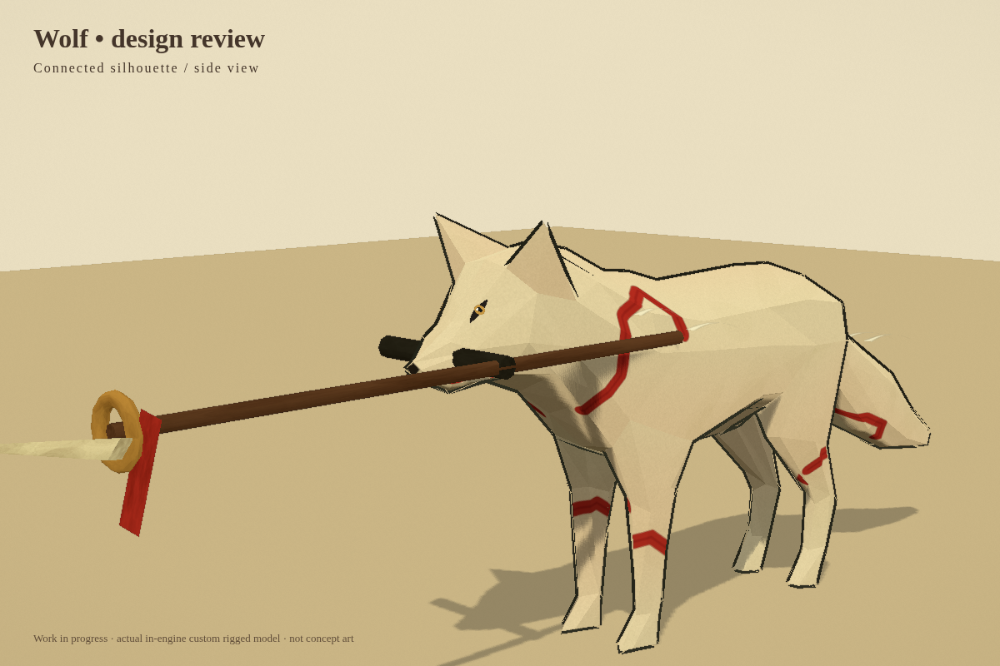
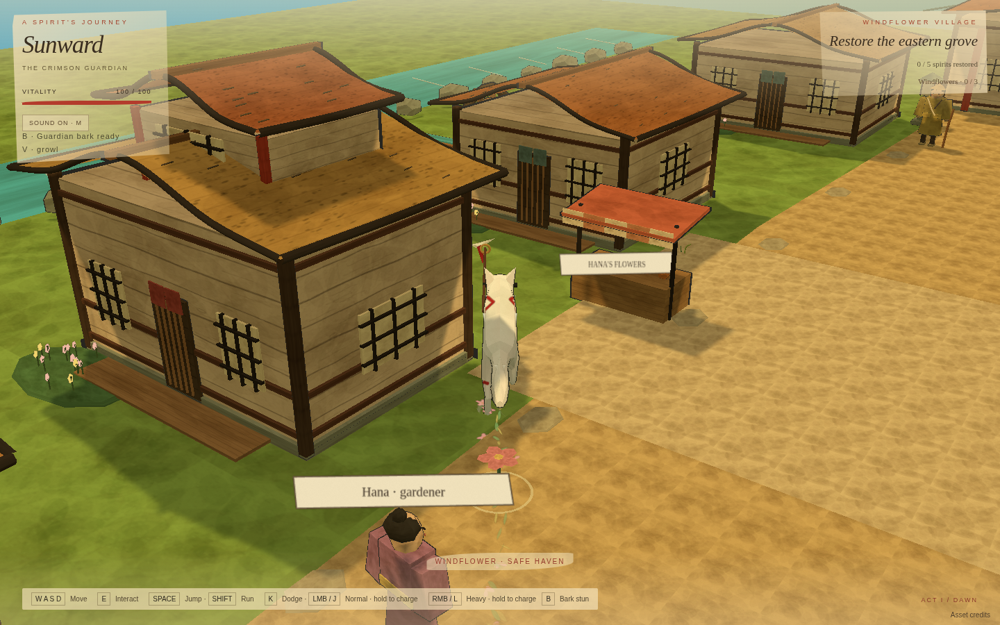
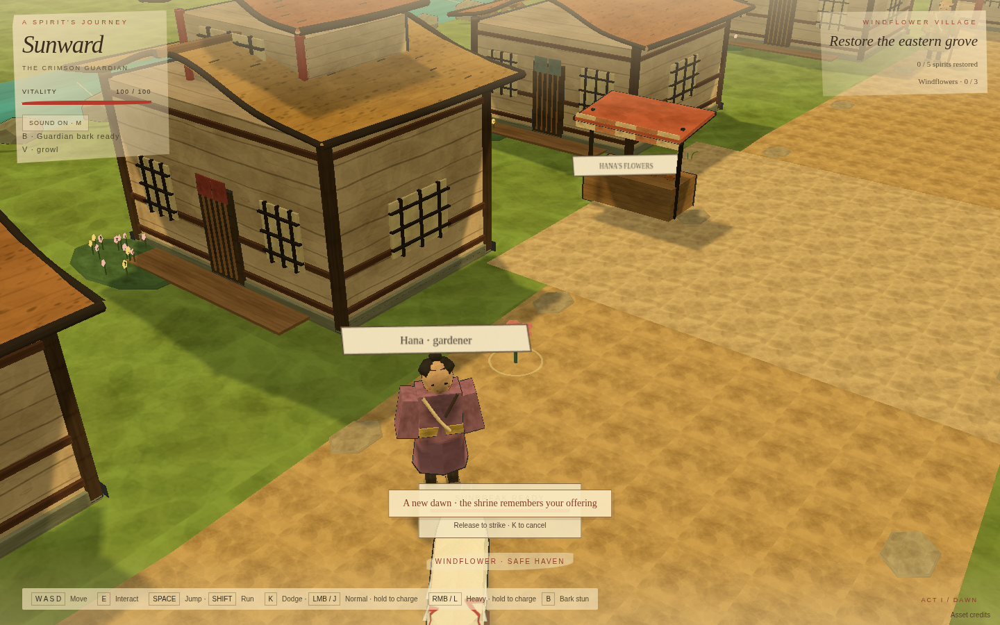

# Latest wolf-focused build

The nine requested additions are implemented: visible animated eyes, vocal choices and damage whimper, bark stun, running blossoms/leaves, charged normal attacks, unique heavy/charged-heavy attacks, aerial attack, improved jump transitions, and silky fur wisps.

## Controls

| Input                             | Action                                 |
| --------------------------------- | -------------------------------------- |
| Tap left click / J                | Normal combo                           |
| Hold then release left click / J  | Charged Dawn Thrust                    |
| Tap right click / L               | Heavy Moon Arc                         |
| Hold then release right click / L | Charged Sunbreak                       |
| Left click / J in a jump          | Falling Star dive                      |
| B                                 | Guardian Bark stun (6-second recovery) |
| V                                 | Selected soft bark, growl or howl      |
| Escape                            | Pause and choose the voice option      |

Production build passed. Browser checks: **38/38passed**. [General report](VALIDATION_REPORT.json) · [Wolf report](WOLF_FEATURE_REPORT.json) · [Build log](BUILD_LOG.md).

## Actual browser previews

### Face close-up

### Running foliage

### Heavy charge

The face close-up uses the in-engine model review stage. The other captures are the actual game. Still images cannot demonstrate animation or sound quality.
