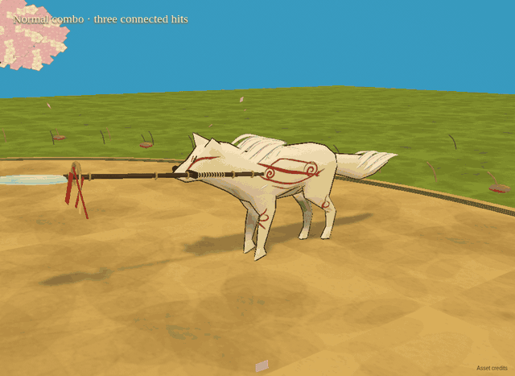
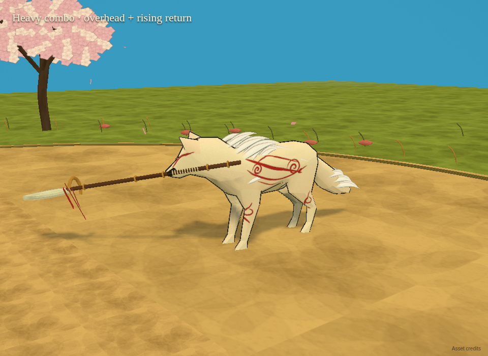
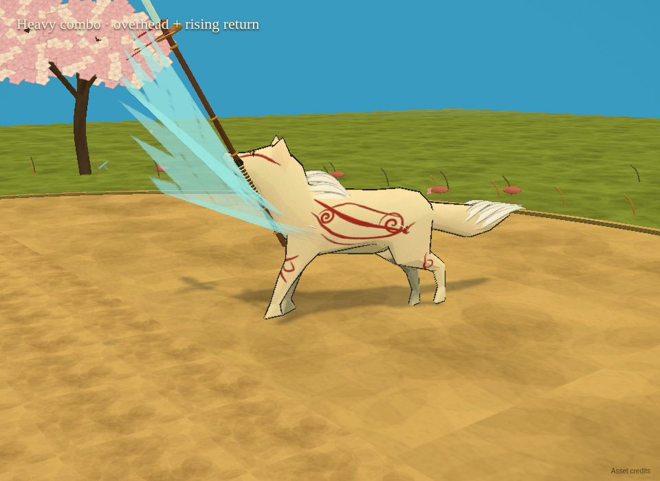
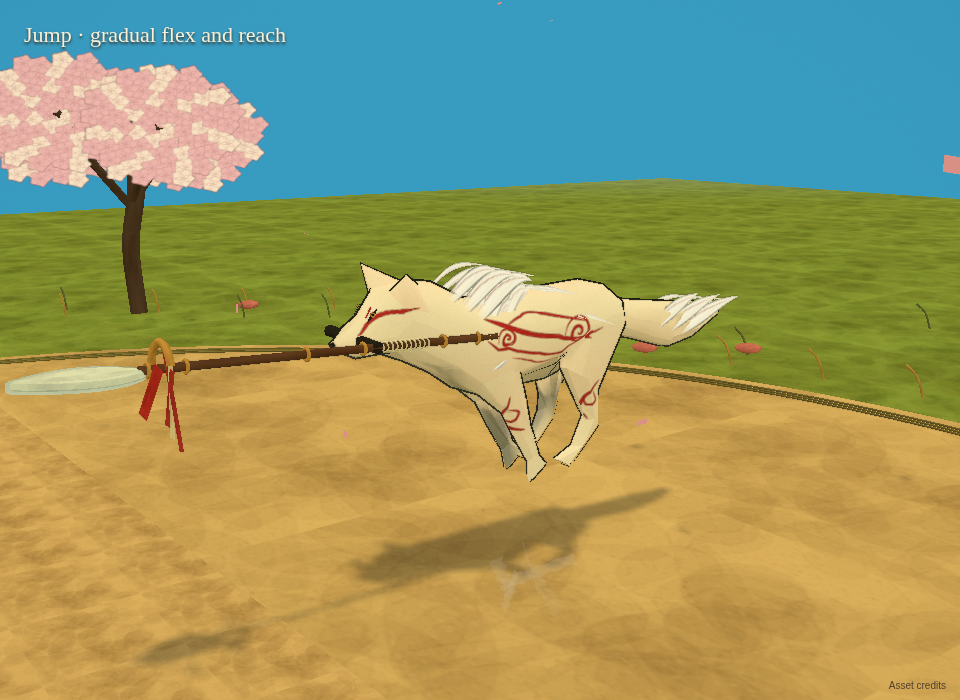
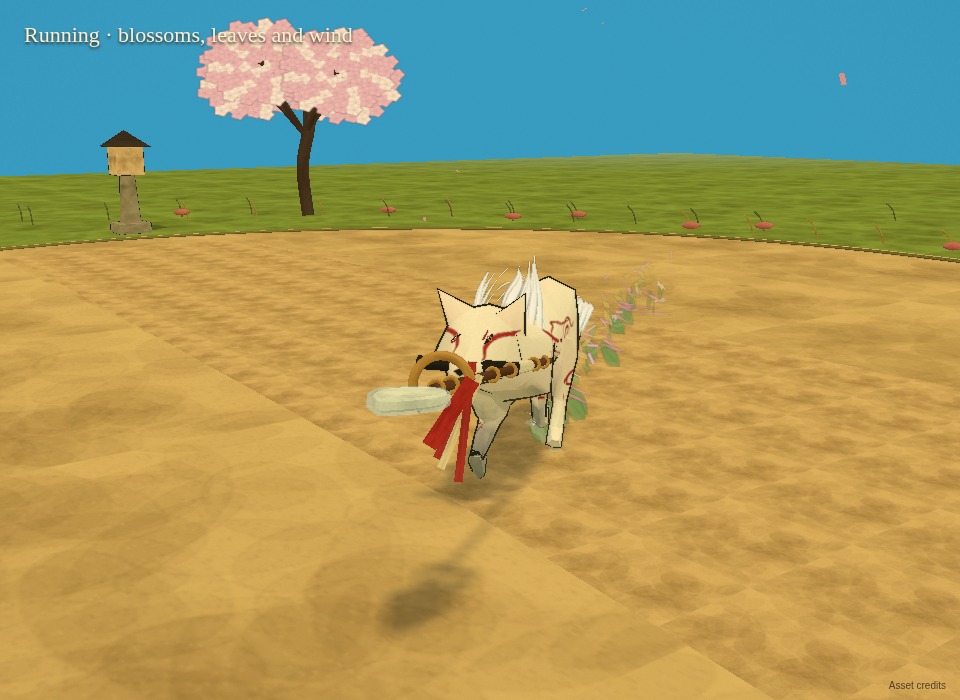

# Connected combat and wolf motion — 13 October 2026

The next build revises the user's reopened items 1–9. Approved eyes, vocal sound clips and spear artwork remain in place.

## Watch the next build before downloading

This is an actual game capture, stepped at 20 simulation frames per second, with a close-up review camera and scripted keyboard equivalents of left/right clicks. The enemies were moved out of the clearing to keep the wolf visible. It shows the complete three-hit normal string, the two-hit heavy string, the progressive jump and running effects. GIF playback has no sound and is reduced to 15 fps for download size. Functional gameplay checks use the regular game camera and inputs.

## Changes for this playtest

- Normal combo: stepping Reed Crosscut → weight-shifting Crescent Sweep → springing Sunward Vault, with shoulder/hip turns, forepaw asymmetry, anticipation and follow-through.
- Heavy combo: overhead Sky Cleaver → Rising Tempest return, connected by an early buffered press or a short recovery window. The string ends after two hits. Holding still produces the charged heavy.
- Body/weapon contact: reduced excessive downward bends, posed-skin ground support, and a safe spear angle while preserving its mouth grip.
- Jump: considerably less leg folding; gradual flex on ascent, continuous apex, gradual reach on descent and landing absorption.
- Charged/aerial polish: counterbalance/recoil, gentler dive entry tuck and retained distinct slam with grounded recovery.
- Anatomy: rounded torso cross section and shoulder/neck shaping; welded coincident source vertices so body shading can actually blend across triangles, while retaining source UVs and skin weights.
- Red paint: tapered curved shoulder/flank/leg spirals projected onto the mesh's own UV triangles, replacing straight atlas bands and attached cream shoulder badges.
- Fur: more integrated chest/neck layers, roots attached to deforming skin triangles, fading joins and correlated wind with tip/turn lag.
- Running effects: sprouting green sprigs, elevated blossoms, ground flowers, floating petals and wind-drifting leaves.

## Controls

| Input | Action |
| --- | --- |
| Tap left click / J three times | Connected normal combo |
| Tap right click / L twice | Connected heavy combo |
| Hold/release left click / J | Charged pounce |
| Hold/release right click / L | Charged ground break |
| Click / J during jump | Aerial spike/slam |
| Space | Jump |
| B | Guardian bark stun |
| V | Selected voice |
| Escape | Pause/volume/voice options |

Production build passed. **47 browser checks passed: 20 general + 27 wolf/combat.** Coverage includes both heavy inputs/continuation/reset, real 3-then-4 heavy damage, full posed-body/spear floor clearance, moderate apex leg flex, deforming-skin fur attachments and unchanged audio/eyes behavior. [General report](VALIDATION_REPORT.json) · [Wolf/combat report](WOLF_FEATURE_REPORT.json) · [Build log](BUILD_LOG.md).

The functional checks establish behavior; the user's playtest determines whether the animation and appearance now meet their expectations.

