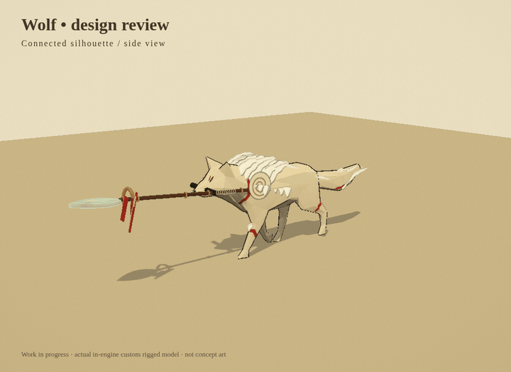
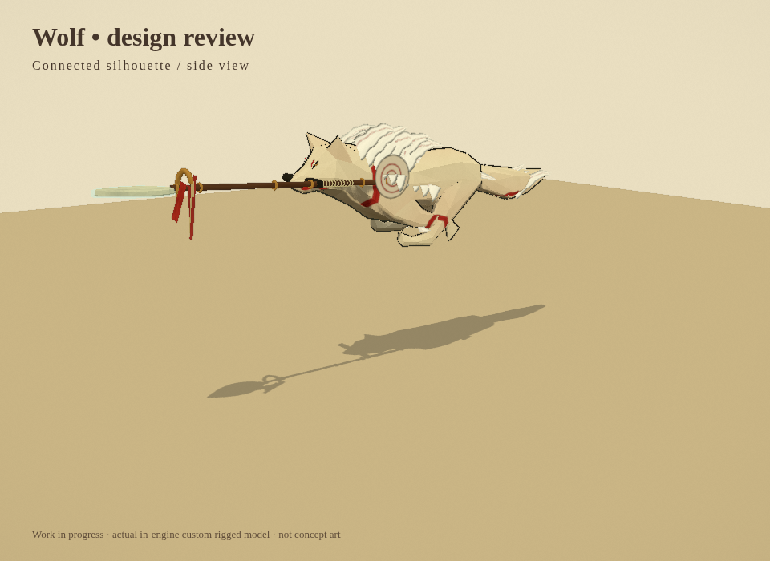

# Wolf and spear revision — 13 October 2026

This replaces the rejected nine-feature draft. The user's Shiranui illustration guided the leaner muzzle/shoulder silhouette, larger swept mane and painted spiral emblems. This is an adapted original canine interpretation; artistic acceptance remains pending.

## Watch before installing

Eight-second loop: walk, run, tucked jump, charged pounce, overhead heavy, aerial spike and recovery. Captured from the actual in-engine model review stage using the game's animation controller. Review-stage jump height is staged; actual input/physics, collision, damage, audio and impact effects were tested separately in the game. The GIF has no audio.

## Ten requested changes

1. Narrower eye shapes, restrained iris/highlight, painted brow accents.
2. Real dog bark and licensed wolf vocal clips replace oscillator vocals. First-use decoding queues the vocal; stun bark has verified output energy. Damage uses varied hurt cries. Credits and audio licenses are included.
3. Varied flower color/scale and softer leaf motion.
4. Charged normal coils low, then pounces with raised forepaws, separately from the normal thrust.
5. Heavy raises the spear overhead and cleaves downward; charged heavy drives a stronger ground break.
6. Aerial attack briefly tucks, dives nose-down and deals a radial landing hit with dedicated slam audio, expanding rings, dust and painted debris.
7. Jump poses preserve the artist rig's natural limb bends, fold the paws at the apex and reach toward landing. Stale action weights are cleared.
8. Broader muzzle/shoulders, narrower loin, shorter ears and bold spiral shoulder emblems.
9. Twenty-nine larger layered mane/shoulder/ankle/tail tufts with ink edges, red detail and varied flowing tips replace the tiny wisps.
10. Leaf-shaped spectral blade, wrapped grip, metal collars, moving tassels, attack-specific spear pitch, pale trails and drifting spectral flecks.

## Controls

| Input | Action |
| --- | --- |
| Tap left click / J | Normal combo |
| Hold/release left click / J | Charged pounce |
| Tap right click / L | Overhead Sky Cleaver |
| Hold/release right click / L | Charged Sunbreak |
| Click / J in a jump | Tucked Falling Star spike/slam |
| B | Guardian Bark stun, 6-second recovery |
| V | Voice selected in Pause |
| Escape | Pause, volume and voice options |

Production build passed. **42 browser checks passed: 20 general + 22 wolf.** New regressions inspect folded paw positions, distinguish heavy/charged bone poses, measure audible bark output, and verify aerial damage/sound/rings happen once on landing. These demonstrate functional behavior; visual quality still needs the user's review.

[General report](VALIDATION_REPORT.json) · [Wolf report](WOLF_FEATURE_REPORT.json) · [Build log](BUILD_LOG.md).

## Still previews

