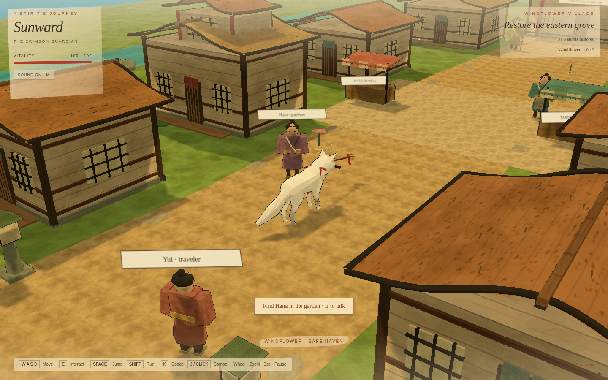
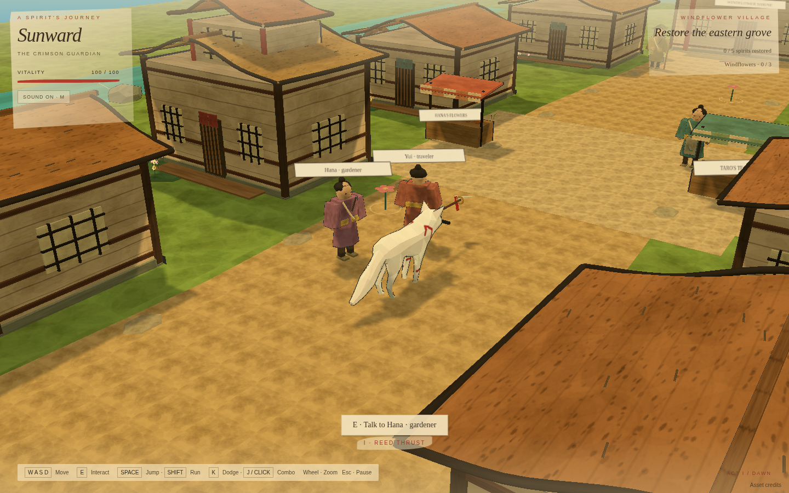
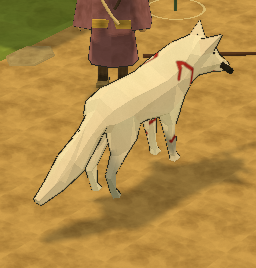

# Latest saved game build

This update contains the artist-rigged painted wolf adaptation, revised attack rhythm and input queues, articulated enemies with staged deaths, painted effects and original sound, a richer town, NPC dialogue, and a windflower/shrine activity.

Production build passed. Browser suite: **20/20passed**. See [validation report](VALIDATION_REPORT.json), [build log](BUILD_LOG.md), and [asset attribution](../THIRD_PARTY.md).

## Actual final browser captures

### Village

### Combat

### Wolf from gameplay camera

The earlier wolf-design-review branch contains superseded draft previews. Use this page for the current saved game. Screenshots demonstrate shape and framing, not animation quality.
