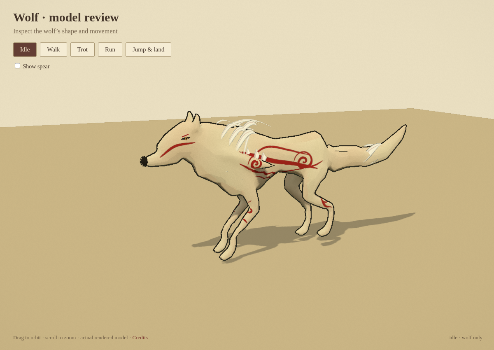
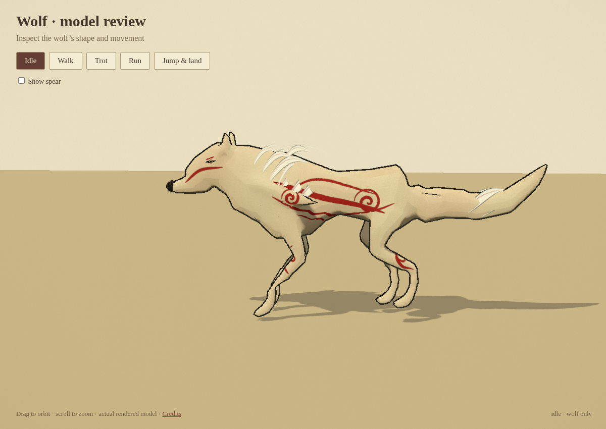
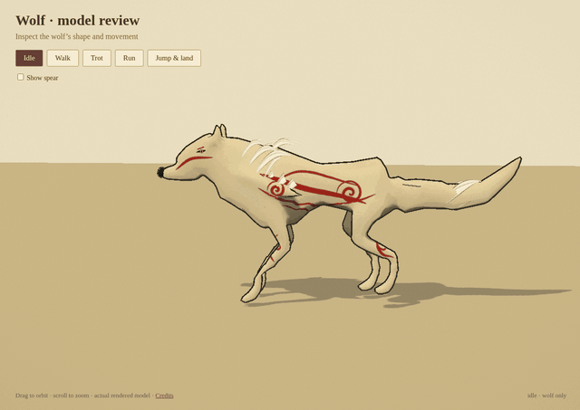

# Wolf-only foundation draft

This branch opens a standalone model viewer. It imports the wolf, Three.js renderer and orbit controls; the town, enemies, quests and game controller are not loaded. The existing game remains on `sunward-minigame`.

This is the actual rendered model, not concept art. The screenshots use a frozen idle pose. The movement loop uses the viewer's animation/ballistic-jump controller, captured at 15 simulation frames per second. No download is needed to inspect these files on GitHub.

## Foundation changes

- New connected mesh built from shaped anatomical surfaces: thorax, tucked waist, haunches, angled leg/hock chains, broad paws/toes, skull/muzzle, ears, neck ruff and tapered tail. The old fox mesh is used only as a skin-weight reference; it is not the rendered coat.
- The licensed canine skeleton and artist walk/run clips remain the core. Added two shoulder-blade parent controls and a weighted mane-flow control, for 27 bones total. This is an extension/rebinding of the existing rig, not a claim that every bone/animation was authored from scratch.
- Fresh skin/UV layout, projected red paint, matched head/nose binding, integrated volumetric ruff and fewer small surface streamers.
- Quieter breathing/forward-facing idle, measured diagonal-foot-phase trot between walk and gallop, progressive jump/landing and skin-based ground support.
- Buttons for idle/walk/trot/run/jump, drag/scroll orbit view, and optional spear visibility.

The production viewer build and five focused browser checks pass. They cover geometry/rig data, changing finite gait poses, complete jump/landing recovery, controls, and absence of map modules or JS/shader errors. [Report](validation.json). These checks do not establish artistic acceptance. This is a draft for visual and movement review, not a finished game release.
