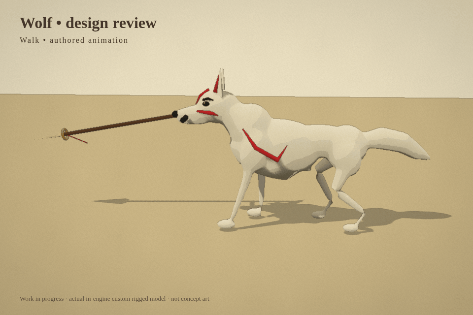
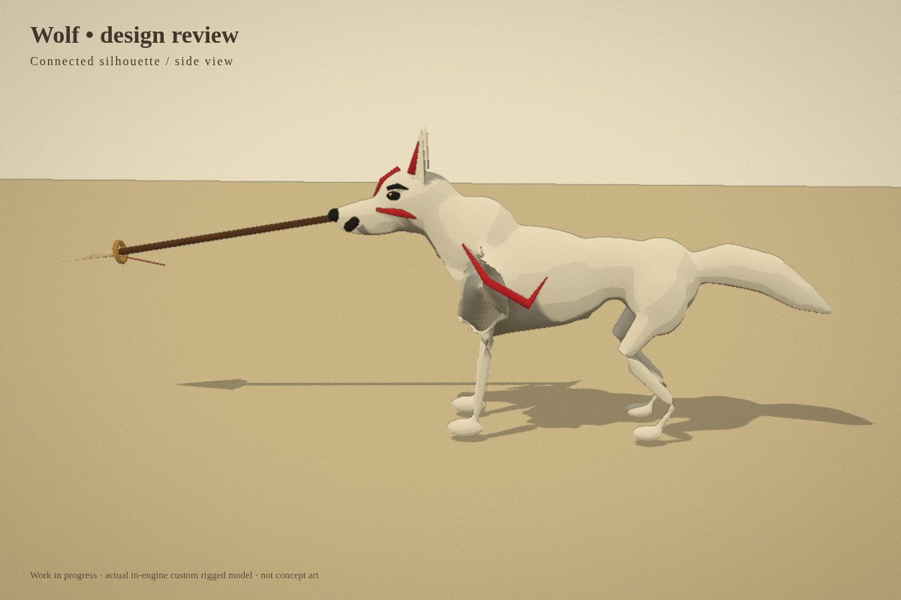
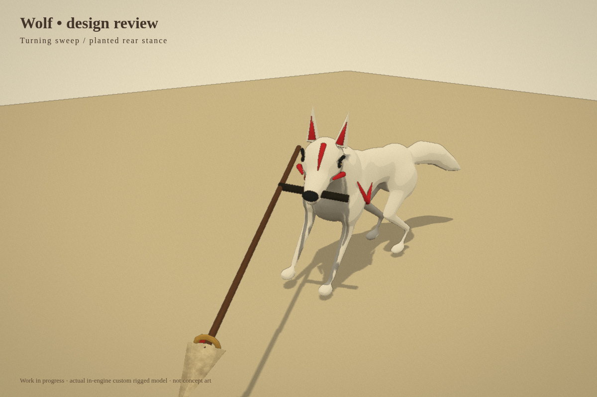
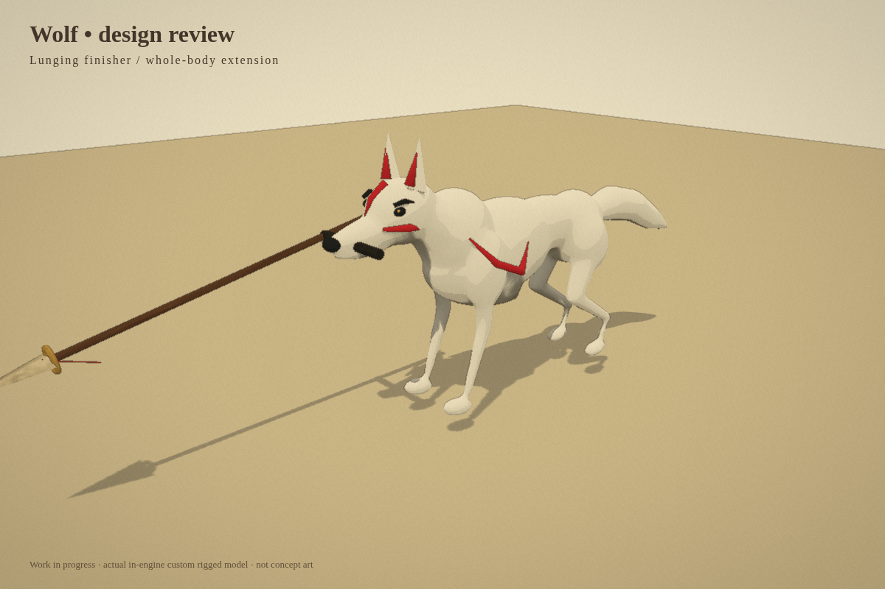
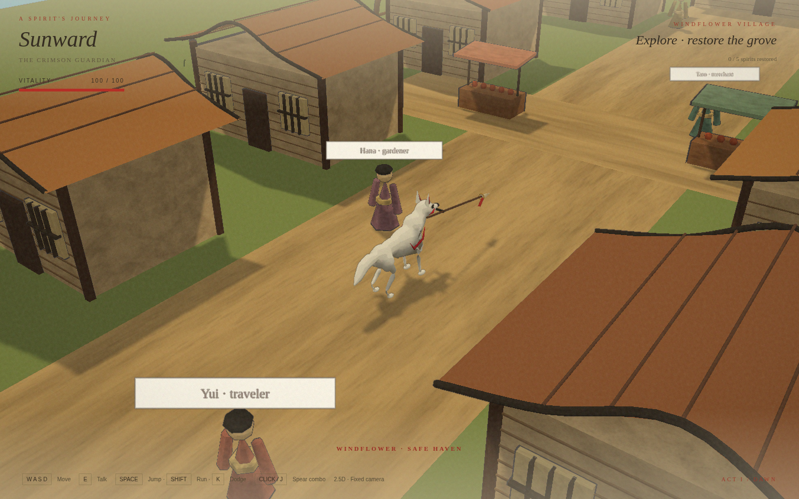

# Custom wolf and animation review

This is an original Blender-built, skinned wolf with eight animation clips. The preview is captured from the actual Three.js renderer, not concept art. This review branch adds only images and motion previews; the revised game code is not included.

## Motion preview

Walk, run, quick thrust, turning sweep, and lunging finisher:

[Open the GIF directly](wolf-motion.gif) | [MP4 version](wolf-motion.mp4)

The model is shown running in place to make its motion easier to inspect. It is a work in progress.

## Side profile

## Turning sweep

## Lunging finisher

## Town gameplay view

